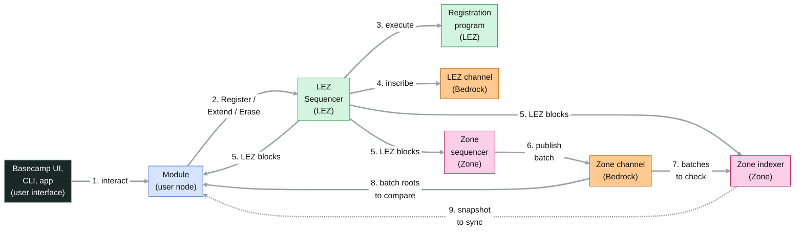
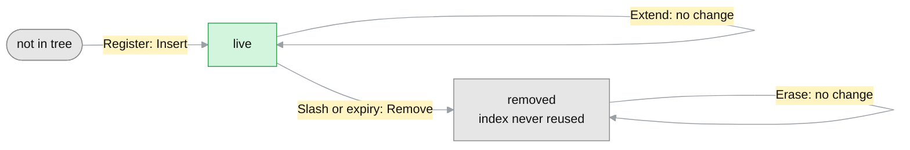
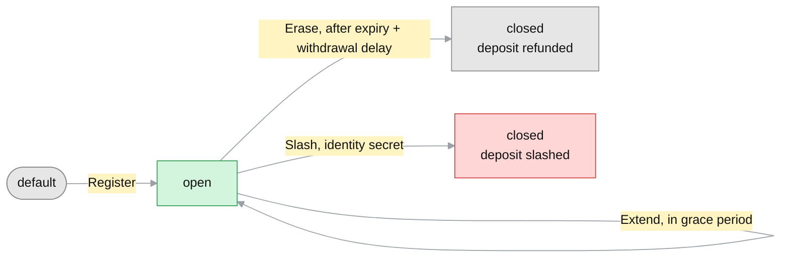
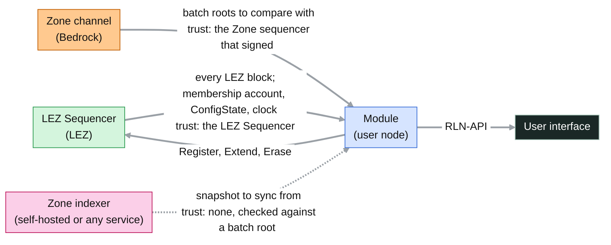

# RLN-MEMBERSHIP-ZONE

| Field | Value |
| --- | --- |
| Name | RLN Membership Zone |
| Slug | TBD |
| Status | raw |
| Category | Standards Track |
| Tags | rln, membership, registry, zone |
| Editor | Vinh Trinh <vinh@status.im> |
| Contributors | |

## Abstract

This document specifies the RLN Membership Zone:
a registry, in the sense of the
[RLN-API](https://lip.logos.co/anoncomms/raw/rln-api.html),
for RLN memberships on the Logos Blockchain.
A membership is bought with a deposit through a registration program
on the Logos Execution Zone (LEZ), which also handles refunds and slashing.
The Zone keeps the Merkle tree of those memberships
and publishes its roots on Bedrock as the reference every node agrees on.

The tree follows from the registration program alone:
fixed rules turn its transactions into insertions and removals,
so any node can compute the same tree straight from LEZ and check it against the Zone's roots.
The RLN Module that RLN-API specifies ("the Module" for short) runs in every user's node
and does exactly that, so that it is as current as LEZ itself.

RLN-API itself does not change; its `logos` namespace binding is filled in as [Module Requirements](#module-requirements) states.

The Zone holds no user funds and has no general-purpose execution environment;
all deposits stay in the registration program.

## Motivation

This draft is written against the current `logos` registry,
the logos-lez-rln implementation ("lez-rln" for short),
and compares with it where that helps a design decision.
The comparisons are temporary.
Once the design decisions are settled and the specification is aligned with RLN-API,
they will be removed, and each repository will implement only its own part.
They appear in this section and in the [Open Questions](#open-questions).

lez-rln keeps the membership set inside LEZ accounts.
Every registration recomputes the rate commitment and every level of the tree
inside the RISC Zero zkVM:

- one registration costs about 9.09M execution gas against `MAX_GAS_EXEC`,
  10M per transaction and per LEZ block, so a LEZ block holds at most one registration;
- at the floor execution base fee (`BASE_FEE_EXEC_MIN`, 8 atomic units per gas)
  its execution fee alone is about 72.7M atomic units;
- every registration exceeds the 5M `TARGET_GAS_EXEC`,
  so sustained registration raises the LEZ base fee for all LEZ users by about 10% per LEZ block;
- the tree is limited to depth 9 (512 leaves over its lifetime) to fit `MAX_GAS_EXEC`,
  which forces a non-standard depth-10 circuit on proof generators
  (the Merkle proof path is padded with one empty sibling).

None of this cost is intrinsic to RLN; it comes from hashing inside the zkVM.
A registry needs only ordered, available, verifiable changes to its membership set,
which LEZ already provides to anyone who reads it,
and the hashing can run outside the zkVM.
Deriving the membership set from LEZ removes the hashing from the zkVM,
raises the tree depth to 20 (the default depth Zerokit ships),
keeps only the deposit logic on LEZ,
and lets a Module that serves messaging stay as current as LEZ itself.

## Semantic

The key words "MUST", "MUST NOT", "REQUIRED", "SHALL", "SHALL NOT",
"SHOULD", "SHOULD NOT", "RECOMMENDED", "MAY", and "OPTIONAL" in this document
are to be interpreted as described in [RFC 2119](https://www.ietf.org/rfc/rfc2119.txt).

## Terminology

Every term not listed here keeps the meaning and spelling of its source:
RLN-API first, then RLN Membership Allocation, RLN-V1 and RLN-V2, the Zerokit-API,
and the Logos Blockchain specifications and code ([References](#references)).

"The Module" is short for the RLN Module that RLN-API specifies; every user node runs its own instance.
"Epoch" is always the RLN epoch, never the Cryptarchia epoch.

This document adds:

| Term | Meaning |
| --- | --- |
| The Zone | The RLN Membership Zone specified here; "a Zone" or "Zones" means any Logos Zone (glossary), LEZ included. |
| Zone channel | The channel of the Zone, written by the Zone sequencers. |
| Batch | The payload of one `CHANNEL_INSCRIBE` in the Zone channel, carrying the membership-set changes of a contiguous range of LEZ blocks `[from_lez_block_id, to_lez_block_id]`. |
| Reader | Anything that applies the Derivation Rules to the LEZ blocks and holds the tree: a Zone sequencer, a Zone indexer or a Module. |
| Zone indexer | A reader that checks every batch of the Zone channel against what it derived and MAY serve snapshots of its tree to Modules that sync; it holds no identity and runs no RLN-API. Distinct from the LEZ Indexer. |
| Zone operator | The party that holds the accredited keys of the Zone channel, runs the Zone sequencers, pays their Mantle Transaction fees and receives `registration_fee` at `operator_account_id` ([LEZ Requirements](#lez-requirements)); one party in this draft. |

## Overview

This section shows who takes part and how a membership moves through the system;
the following sections specify each part.

### Assumptions

- Bedrock totally orders and finalizes channel inscriptions and keeps them available.
- LEZ blocks are inscribed on Bedrock in the LEZ channel.
  A LEZ block has no finality of its own: it is final once the Bedrock block holding its inscription is.
- The LEZ Sequencer serves the LEZ blocks it has closed and does not change one afterwards,
  also when it inscribes a block again after a Bedrock reorg.
  Every LEZ consumer already relies on this, so every reader takes LEZ blocks from the LEZ Sequencer
  without waiting for their finality, and rolls back only if the assumption fails ([Derivation Rules](#derivation-rules)).
- The Zone sequencers are trusted the same way:
  Zone indexers check a batch once it is in a Bedrock block, and Bedrock finality later confirms it.
  A dishonest sequencer on either side is caught by recomputation, not prevented.
- Each LEZ block carries a `timestamp` in Unix-epoch milliseconds,
  which the clock program writes to the clock accounts.
  This is the registry's time base, as the `logos` namespace binding that RLN-API requires.
- Rate commitments are `poseidon(id_commitment, rate_limit)`,
  with Poseidon or Poseidon2 over BN254 as in the Zerokit-API.
- The membership set is a Merkle tree of depth 20, append-only in leaf indices:
  a removed leaf is set to the empty value and its index is never reused,
  so the leaf capacity is 2^20 memberships over the registry's lifetime.
- Only accredited keys write to the Zone channel
  ([Mantle channel operations](https://lip.logos.co/blockchain/raw/bedrock-v1.1-mantle-specification.html));
  anyone reads it.
- Every node that runs a Module can hold the tree and follow LEZ:
  a few megabytes at today's membership counts, about 64 MB of tree at the leaf capacity.

### Components

| Component | Runs where | Holds | Interacts with |
| --- | --- | --- | --- |
| User interface | the user's node: the Basecamp RLN membership UI, a CLI, or an app such as a Logos Delivery node | nothing RLN-specific | calls its Module through RLN-API (`register`, `generate_proof`, `validate_proof`) |
| Module | inside the user's node | keystore, membership records, the tree and its registry view (valid-root window, Merkle proof paths, statuses), nullifier log, message-id allocation, a funded account on LEZ (or a membership provider registers on its behalf) | sends `Register`, `Extend` and `Erase` to LEZ and reads its membership account there; derives the tree from the LEZ blocks; compares its roots with the batches on Bedrock; syncs from a Zone indexer's snapshot, or by replaying LEZ, when it starts ([Module Requirements](#module-requirements)) |
| LEZ Sequencer | LEZ | LEZ state and mempool | receives transactions from the Module and the slasher; serves each LEZ block it closes and inscribes it in the LEZ channel on Bedrock |
| LEZ Indexer | any host | the LEZ blocks, events and accounts | serves history to readers that replay, and event filtering; not on the live path, which reads the LEZ Sequencer |
| Registration program | LEZ | configuration account, escrow, membership accounts | runs when the LEZ Sequencer executes a transaction that calls it, directly or through a chained call |
| Bedrock | Logos Blockchain nodes | the LEZ channel (LEZ blocks) and the Zone channel (batches), totally ordered and finalized up to the latest immutable block (LIB); the notes that pay Mantle Transaction fees | lets anyone read every channel; lets only accredited keys write to their channel |
| Zone sequencer | the Zone operator's hosts, one per accredited key | the tree, node wallet notes, the batch in flight | reads LEZ blocks from the LEZ Sequencer; publishes batches to the Zone channel on Bedrock; takes no input from any Module |
| Zone indexer | any host; holds no accredited key | the tree, root history `(root_after, to_lez_block_id)`, Rejected batches as evidence | reads LEZ blocks from the LEZ Sequencer; reads batches from Bedrock and checks each against what it derived; serves snapshots to Modules that sync |
| Slasher | any host | a funded account on LEZ | gets `recovered_secret` from its Module; sends `Slash` to LEZ |

The Module acts as proof generator when it calls `generate_proof`
and as validator when it calls `validate_proof`, as RLN-API calls these roles;
the same Module plays both.
LEZ never reads the Zone and the Zone never writes to LEZ.
Reading LEZ costs no gas, so the registry adds no LEZ load beyond its own transactions.

### A membership's life

The Module generates an identity credential and sends `Register` from its funded account.
The registration program moves the deposit to the escrow
and assigns the next leaf index.
As soon as the LEZ Sequencer closes the LEZ block holding the `Register`,
every reader inserts the leaf into its tree,
and the membership is `MEMBERSHIP_ACTIVE` at every Module that has applied that block.
The Zone sequencer publishes the `Insert` in a batch on Bedrock;
once the batch is in a Bedrock block, every Zone indexer checks it against what it derived,
and every Module confirms its own root against it.
The holder MAY send `Extend` during the grace period.
At expiry every reader removes the leaf.
After the withdrawal delay the holder sends `Erase` and gets the deposit back.
If the member double-signals, a validator recovers the identity secret
and a slasher sends `Slash`:
the deposit is slashed to the treasury, and every reader removes the leaf as soon as the LEZ Sequencer closes the block holding the `Slash`.

### Flow

Registration (steps 1-9): a user action reaches the registration program on LEZ; every reader derives the new root from the LEZ block, and the Zone's batch confirms it.



Messaging and slashing (steps 10-15): a double-signal reveals the identity secret, a slasher slashes the deposit, every reader removes the leaf, and the Zone's batch confirms it.

```mermaid
%%{init: {"theme": "base", "flowchart": {"curve": "basis", "nodeSpacing": 40, "rankSpacing": 70, "padding": 6}, "themeVariables": {"lineColor": "#9aa0a6", "primaryTextColor": "#111111", "edgeLabelBackground": "#ffffff", "fontSize": "15px"}, "themeCSS": "marker { overflow: visible; } .arrowMarkerPath { transform: scale(1.7); transform-origin: 5px 5px; } .edgeLabel, .edgeLabel p, .edgeLabel span { font-size: 12px; line-height: 1.2; }"}}%%
flowchart LR
    SND["Module - proof generator<br/>(user node)"] -->|"#nbsp;10. message + proof#nbsp;"| VAL["Module - validator<br/>(other node)"]
    VAL -->|"#nbsp;11. recovered_secret#nbsp;"| SL["Slasher<br/>(any node)"]
    SL -->|"#nbsp;12. Slash#nbsp;"| PROG["Registration program<br/>(LEZ)"]
    PROG -->|"#nbsp;13. LEZ block with the Slash#nbsp;<br/>#nbsp;(every reader removes the leaf)#nbsp;"| VAL
    PROG -->|"#nbsp;14. next batch (Zone sequencer):#nbsp;<br/>#nbsp;Remove#nbsp;"| IDX["Zone indexer<br/>(Zone)"]
    linkStyle default stroke-width:2.5px

    classDef user fill:#d6e4ff,stroke:#3b6fd8,color:#111111
    classDef lez fill:#d4f5dd,stroke:#2e9b52,color:#111111
    classDef zone fill:#fbcfe8,stroke:#be185d,color:#111111
    class SND,VAL,SL user
    class PROG lez
    class IDX zone
```



| Step | Action | When |
| --- | --- | --- |
| 1 | The user interface (Basecamp UI, CLI or an app) calls the Module through RLN-API. | Whenever the user acts: registers, renews or withdraws a membership. |
| 2 | The Module sends `Register`, `Extend` or `Erase` to the LEZ Sequencer, signed by the funded account (`Register`) or the `holder` (`Extend`, `Erase`). | `Register` once per membership; `Extend` in the grace period; `Erase` after the withdrawal delay. |
| 3 | The LEZ Sequencer executes it with the registration program; for `Register`: the checks, the deposit to the escrow, `registration_fee` to the Zone operator, a new `leaf_index`. | In the same LEZ block. |
| 4 | The LEZ Sequencer inscribes the LEZ block in the LEZ channel on Bedrock. | Every LEZ block. |
| 5 | Every reader (the Zone sequencer, every Zone indexer, every Module) reads the LEZ block from the LEZ Sequencer and applies the derivation rules; a Module has the new root now. | As soon as a LEZ block is closed. |
| 6 | The Zone sequencer publishes a batch with the changes and the root to the Zone channel. | On its turn to write, covering every LEZ block not yet covered. |
| 7 | The Zone indexer reads the batch from the Zone channel and compares it with the changes and the root it derived at step 5. | Once the batch is in a Bedrock block; Bedrock finality confirms it about 60 min later on testnet. |
| 8 | The Module compares the batch root with its own root for the same LEZ block. | In the background, never while validating a message. |
| 9 | A Module that starts, or fell behind, takes a snapshot from a Zone indexer, checks its root against the batch for the same LEZ block, and applies the blocks since; until then it answers `RLN_ERR_NOT_READY`. | At start, or after a long disconnection. |
| 10 | The sender's Module, as proof generator, sends a message with its RLN proof; another node's Module, as validator, checks it. | Every message. |
| 11 | The validator detects a double-signal and hands `recovered_secret`, the identity secret, to a slasher, or sends the `Slash` itself. | When a nullifier repeats with a different `share_x`. |
| 12 | The slasher sends `Slash{identity_secret}`; the registration program slashes the deposit to the treasury. | As soon as the slasher has the identity secret. |
| 13 | Every reader applies the LEZ block holding the `Slash` and removes the leaf; every validator drops the roots from before it. | As soon as that block is closed. |
| 14 | Steps 5-7 run again: the next batch carries `Remove{leaf_index}` for the slashed leaf. | In the next batch. |
| 15 | Zone indexers and Modules confirm their root against the batch. The violator's Module reports `MEMBERSHIP_SLASHED` from its membership account on LEZ since step 12. | Once that batch is in a Bedrock block. |

The following sections specify the [Derivation Rules](#derivation-rules) every reader applies (steps 5 and 13),
the [Zone Sequencer](#zone-sequencer) (steps 6 and 14) and the [Zone Indexer](#zone-indexer) (steps 7, 9 and 15),
then what the registry requires from LEZ ([LEZ Requirements](#lez-requirements), steps 2-4 and 12)
and from the Module ([Module Requirements](#module-requirements), steps 1, 5, 8-11, 13 and 15).
The [Open Questions](#open-questions) follow.

## Derivation Rules

These rules turn the registration program's transactions into the membership set.
The Zone sequencer, every Zone indexer and every Module apply the same rules to the same LEZ blocks,
so they hold the same tree and the same roots.
A change is an `Insert{leaf_index, rate_commitment}` or a `Remove{leaf_index}`,
the two operations the current LEZ Merkle program performs;
this design moves them from LEZ into the readers.

For every LEZ block, in order,
and every successful registration-program transaction in that LEZ block, in the block's order:

- `Register` produces `Insert{leaf_index, rate_commitment}`,
  with the membership account's `leaf_index` and `poseidon(id_commitment, rate_limit)`.
- `Slash` produces `Remove{leaf_index}`, if the leaf is live.
  A `Slash` after the leaf expired produces no change,
  but the Module still reports `MEMBERSHIP_SLASHED` ([Membership status](#membership-status)).
- `Extend` produces no change; the reader takes the new `expiry_timestamp_ms` from the transaction
  and keeps it for the expiry step below.
- `Erase` produces no change, since it needs `now >= expiry_timestamp_ms + withdrawal_delay_ms`
  and the expiry step of an earlier LEZ block has already removed the leaf.
  If the leaf is still live, which the registration program must never allow,
  it produces `Remove{leaf_index}`.

After the transactions of a LEZ block, every live leaf whose `expiry_timestamp_ms` is at or below
that LEZ block's `timestamp` produces `Remove{leaf_index}`, in increasing leaf index.
A leaf expires at most once.
Why a leaf was removed is not part of the tree; readers that need it take it from LEZ.



A reader applies a LEZ block as soon as the LEZ Sequencer serves it.
Should the LEZ Sequencer ever inscribe a different block under a known `block_id`,
every reader rolls its tree back to the block before it and applies the new blocks,
every batch covering that block or a later one is void,
and the Zone sequencer publishes again from the block before it;
how many blocks a reader keeps for this is open.

## Zone Sequencer

This section specifies what a Zone sequencer publishes.
It derives the membership set with the rules above and writes the result to Bedrock,
so that every reader has a reference to compare with and anyone can audit the registry from public data.

### Batch format

```protobuf
syntax = "proto3";

message Batch {
  uint64          from_lez_block_id = 1;  // first LEZ block_id covered, inclusive
  uint64          to_lez_block_id   = 2;  // last LEZ block_id covered, inclusive
  repeated Change changes           = 3;  // in derivation-rule order
  bytes           root_after        = 4;  // 32 bytes, little-endian, membership-set root after the changes
}

message Change {
  oneof kind {
    Insert insert = 1;
    Remove remove = 2;
  }
}
message Insert { uint64 leaf_index = 1; bytes rate_commitment = 2; }  // 32 bytes, little-endian
message Remove { uint64 leaf_index = 1; }
```

One batch per `CHANNEL_INSCRIBE`, carried by one Mantle Transaction.
A batch carries only what changes the tree; each leaf's expiry and the reason for a removal are read from LEZ.

### Publishing

- The Zone sequencers, one per accredited key, take turns to write in Mantle's round-robin;
  `posting_timeout` passes a missed turn to the next one.
  On its turn, a Zone sequencer SHOULD publish one batch covering every LEZ block the LEZ Sequencer has closed
  and no Verified or in-flight batch has covered, when there are changes,
  and an empty batch once `heartbeat_ms` have passed without a batch.
  It SHOULD publish within `max_delay_ms` of the first unpublished change
  (both Zone sequencer configuration, like the fee cap of its node wallet);
  a slow Zone sequencer shows publicly in how far the batches trail LEZ, and nothing else enforces it.
- A batch covers whole LEZ blocks.
  When their changes would exceed one inscription
  (1,835,008 bytes, the node's inscription limit:
  the 2 MiB Bedrock block less 1/8 for the rest of the Mantle Transaction),
  the batch MAY stop before the latest LEZ block and the next batch continues from there;
  a single LEZ block that does not fit is open.
- A batch with no changes is still valid: it states that the LEZ blocks in its range left the tree unchanged,
  and moves `to_lez_block_id` forward so anyone can tell how far the Zone has followed LEZ.
- A batch is in flight (queued or in the mempool) until its Mantle Transaction is in a Bedrock block.
  The Zone operator's node wallet pays each publish with one whole note and holds it until then,
  so a Zone sequencer can have no more batches in flight than the wallet has spendable notes,
  and MUST keep that many notes available.
  One batch in flight is the simple choice: it needs no note management and loses no throughput,
  since the next batch covers every LEZ block closed in the meantime,
  and a dropped batch invalidates every batch published after it.

Zone indexers mark each batch Verified or Rejected ([Zone Indexer](#zone-indexer)) in Bedrock order,
and a Zone sequencer checks its own batches the same way,
so it sees a Rejected batch of its own and publishes again from the last Verified one.
If a reorg drops or reorders a batch, the Zone sequencer publishes it and every batch after it again, unchanged;
a batch Rejected on its range because of a reorg is no misbehaviour.
If the mempool drops a batch, the Zone sequencer builds it again.
After a restart, a dropped batch or a switch to another Zone sequencer,
a Zone sequencer continues from the last Verified batch on the Zone channel, which it reads as a Zone indexer does.
An outage stops the batches but loses no data or funds:
every reader keeps following LEZ, and the Zone sequencer resumes from LEZ at any time.
The loss of all accredited keys is open.

## Zone Indexer

A Zone indexer derives the membership set with the Derivation Rules
and reads every batch once it is in a Bedrock block, how deep being open, to check it against what it derived.
It MUST reject a batch unless:

1. **Range.** The batch starts right after the last Verified batch ended
   (`from_lez_block_id` = its `to_lez_block_id` + 1; the first batch starts at the registration program's first LEZ block),
   so no LEZ block is skipped or covered twice.
2. **Changes.** `changes` equal what the derivation rules give for that range.
   A LEZ block the Zone indexer cannot read yet only delays the check.
   An omission is provable censorship.
3. **Root.** `root_after` equals the root after applying `changes`.

A batch that passes is Verified, and `(root_after, to_lez_block_id)` joins the root history.
A Rejected batch changes nothing: `to_lez_block_id` stays where the last Verified batch left it,
so the next batch must continue from there, and any batch that continues from a Rejected one is Rejected too.
The Zone sequencer runs the same checks and publishes a correct batch again from the last Verified one.
A batch a reorg removes comes back unchanged; one that comes back different is Rejected.
A batch Rejected on its changes or its root is public evidence against the Zone operator:
the batch, signed by an accredited key, and the LEZ blocks it should match.
What follows from it is outside this document.

A Zone indexer is not on the path of any proof: every Module holds the tree itself.
It MAY serve its verdicts, and snapshots of its tree, each tagged with the `to_lez_block_id` of a Verified batch,
so that a Module syncs in seconds instead of replaying LEZ;
the Module checks the snapshot's root against that batch before using it.
The snapshot format is open.

## LEZ Requirements

The registry depends on a registration program on LEZ.
This document does not specify that program; it requires the following.

- **Clock.** The program reads `now` from the clock account `CLOCK_01`,
  the `timestamp` of the previous LEZ block.
- **Custody.** Every deposit sits in an escrow that only the program can spend;
  the program keeps no Merkle tree.
- **Accounts.** `ConfigState` is the anchor of the registry; one `MembershipState` exists per identity commitment:

  ```rust
  struct ConfigState {
      zone_channel_id: [u8; 32],      // Zone channel on Bedrock that carries the batches
      treasury_account_id: [u8; 32],  // receives slashed deposits
      operator_account_id: [u8; 32],  // receives registration_fee
      next_index: u64,                // leaf index the next Register takes; never goes back
      min_rate_limit: u64,            // lowest rate_limit a Register may take
      max_rate_limit: u64,            // highest rate_limit a Register may take
      price_per_unit: u128,           // deposit = rate_limit * price_per_unit
      registration_fee: u128,         // non-refundable, paid with every Register
      min_active_duration_ms: u64,    // shortest active duration at Register and Extend
      max_active_duration_ms: u64,    // longest active duration at Register and Extend
      grace_period_duration_ms: u64,  // Extend allowed in [expiry - grace, expiry)
      withdrawal_delay_ms: u64,       // Erase allowed from expiry + delay
      epoch_size_sec: u64,            // declared for the RLN-API registry parameters read
  }

  struct MembershipState {
      leaf_index: u64,                // position in the tree, fixed at Register
      rate_limit: u64,                // messages per epoch; part of the rate commitment
      expiry_timestamp_ms: u64,       // set by Register, raised by Extend
      holder: [u8; 32],               // signs Extend and Erase; Erase refunds here
      deposit_amount: u128,           // rate_limit * price_per_unit, held in the escrow
  }
  ```

- **Withdrawal delay.** `withdrawal_delay_ms` SHOULD cover the longest a validator may trail LEZ
  plus the time to detect a double-signal and include the `Slash`,
  so that every validator has applied the expiry, and any slash has landed, before the deposit can leave the escrow;
  how long a validator may trail LEZ is open.
- **Leaf indices.** `Register` assigns them in order, never reuses one, and fails at 2^20.
- **One registration per identity commitment.** A closed membership account never opens again.
- **Visibility.** Every successful action, with the fields the derivation rules use,
  can be read from the LEZ blocks the LEZ Sequencer serves.



| Action | Signer | Allowed when | Effect |
| --- | --- | --- | --- |
| `Register{id_commitment, rate_limit, expiry_timestamp_ms}` | funded account | within the `ConfigState` bounds; membership account default; leaf capacity left | deposit `rate_limit × price_per_unit` to the escrow, `registration_fee` to `operator_account_id`; `holder` = signer; next leaf index |
| `Extend{id_commitment, expiry_timestamp_ms}` | `holder` | open; `now` in the grace period; new expiry later than the old one and within the active-duration bounds from `now` | new expiry |
| `Erase{id_commitment}` | `holder` | open; `now >= expiry_timestamp_ms + withdrawal_delay_ms` | deposit refunded to `holder`; closed |
| `Slash{identity_secret}` | anyone | membership account for `poseidon(identity_secret)` open | deposit to `treasury_account_id`; closed |

There is no early exit: a membership lasts until its expiry,
and a holder who wants a shorter term chooses a shorter `active_duration_ms`.

## Module Requirements

The Module uses this registry through RLN-API, under the `logos` namespace binding of RLN-API Appendix A.
Everything not stated here is as in RLN-API; this document requires the following.



- **Reads from LEZ.** From the LEZ Sequencer: every LEZ block, for the tree;
  and its membership account (open or closed, `leaf_index`, `expiry_timestamp_ms`, `holder`),
  `ConfigState` and the clock, for membership status, for when to send `Extend` and `Erase`,
  and for checking `register` arguments.
- **Tree.** The Module is a reader: it applies the derivation rules to every LEZ block,
  keeps the tree, tags each root with the `block_id` that produced it,
  and takes its own Merkle proof path from its tree.
  It keeps enough state to roll back ([Derivation Rules](#derivation-rules)).
- **Sync.** A Module that starts, or that has fallen too far behind to catch up by applying blocks,
  either replays the registration program's transactions from its first LEZ block,
  or takes a snapshot from a Zone indexer and checks the snapshot's root against the batch on Bedrock
  for the same `to_lez_block_id`; then it applies the LEZ blocks since.
  A Module is ready once it trails the latest closed LEZ block by no more than the valid-root window length;
  before that, and whenever it falls further behind, for example when it loses the LEZ Sequencer,
  it answers `RLN_ERR_NOT_READY` rather than validating on stale roots.
- **Compare.** The Module reads the batches on Bedrock only to compare:
  a batch whose `root_after` differs from the Module's root at `to_lez_block_id`,
  while a Zone indexer the Module does not run has Verified it, means a bug on one side,
  and what the Module does then is open.
- **Valid-root window.** A validator accepts a proof against any root in its window.
  The window holds the roots from the last removal the validator has applied on,
  bounded by a length.
  An insertion leaves every earlier root sound, since the leaves in it are still in the tree;
  a removal makes every earlier root unsound, since the removed leaf still proves against them;
  so the window resets at each removal.
  A validator thus stops accepting a removed leaf as soon as it has applied the block holding the `Slash` or the expiry.
  Honest proofs made against a root before the removal fail and are generated again, partial proofs included.
- **Roots for proofs.** A proof generator SHOULD prove against the newest root it holds.
  Validators trail LEZ by different amounts, a few LEZ blocks at most,
  so the window length covers that difference.
- **Binding.** The anchor account is `ConfigState`, and there are no tree accounts.
  `funding_holding_account_id` pays the deposit and `registration_fee`;
  it SHOULD be a public account, since `Erase` refunds `holder` and a refund to a private account id
  lands in an account no key can spend.
  The registry-specific option `active_duration_ms` is the requested active duration,
  defaulting to `max_active_duration_ms`.
  The Module configuration names LEZ access and, for syncing, zero or more Zone indexer endpoints.
- **Registration.** The Module sends `Register` with `expiry_timestamp_ms` = the `timestamp` of its latest applied LEZ block + `active_duration_ms`.
  The program measures the active duration from the later clock of the block that includes the transaction,
  so the duration shrinks by the inclusion delay:
  the Module adds a margin for it, keeping the result within `max_active_duration_ms`;
  otherwise a request near the minimum would be rejected.
  Under delegated registration the membership provider sends that same `Register` from its own funded account
  and therefore becomes `holder`; nothing on LEZ or in the registry tells the two apart,
  and the client acts through its membership provider for `Extend` and `Erase`.
- **Usability.** The Module generates proofs only while LEZ and its tree agree
  (membership account open, the latest applied `timestamp` before `expiry_timestamp_ms`, leaf live in a root of the valid-root window),
  and stops as soon as either side says otherwise.
  This protects an honest Module only.

### Membership status

`MembershipStatus` follows RLN-API, read from the membership account on LEZ and the leaf in the Module's tree.
The Module may read its membership account ahead of applying the block that changed it,
so the cases below state what it reports in between:

- **Registered on LEZ, block not yet applied**: `MEMBERSHIP_PENDING`, never `MEMBERSHIP_FAILED`.
  The confirmation window therefore only has to cover LEZ inclusion.
- **Expired on the LEZ clock, block not yet applied**: `MEMBERSHIP_EXPIRED` at once.
- **Past the withdrawal delay on the latest applied `timestamp`**: `MEMBERSHIP_ERASED_AWAITS_WITHDRAWAL`, not before.
- **Closed by `Slash` on LEZ, block not yet applied**: `MEMBERSHIP_SLASHED` at once.
- **Closed by `Erase` or `Slash`, leaf removed**: `MEMBERSHIP_ERASED` or `MEMBERSHIP_SLASHED`
  by the LEZ transaction that closed the account; batches do not carry it.
- **Membership account held by someone else** (`holder` is neither the Module's funded account
  nor its membership provider's): counts as absent, `MEMBERSHIP_FAILED` after the confirmation window;
  the Module registers again with a new identity credential.

## Open Questions

Questions are ordered by priority.
High blocks a sound deployment, Medium must be settled before implementation, Low is minor.

### Q1. Chained calls in the derivation rules (High)

**Problem.** On LEZ a transaction is a top-level call to one program, which may call other programs through chained calls.
The derivation rules read "successful registration-program transactions",
which misses a `Register` reached through a chained call from another program,
for example a membership provider's program that takes the client's payment and registers in one transaction.
LEZ then has an open membership account and a used leaf index, but no reader has an `Insert`,
and a reader that does look into chained calls computes different changes from one that does not.
Since every Module applies the rules, their input must be defined so that every reader finds the same actions.

**Design choices:**

- **Events.** The registration program emits one event per successful action
  (`Registered{id_commitment, rate_limit, expiry_timestamp_ms, leaf_index}`, `Extended`, `Erased`, `Slashed`)
  as LEZ `ProgramEvent`s, as the bridge program does with `bridge::Deposit`;
  readers derive from these events in block order, whatever the call depth.
  Clean input; the LEZ Indexer already filters events by program and selector; costs the program an event per action.
- **Top-level only.** The registration program refuses chained calls (no caller),
  so a transaction's program id is enough.
  Nothing changes for readers, but no LEZ program can ever register on a user's behalf.
- **State diffs.** Readers derive from the membership accounts' post-states in each transaction,
  whatever instruction produced them.
  State is the truth, but every transaction's accounts must be decoded,
  and `Register` and `Extend` are told apart only by comparing states.

### Q2. Leaf capacity exhaustion (High)

**Problem.** Leaf indices are never reused (`next_index` never goes back, and Zerokit's trees are append-only),
so the registry holds 2^20 memberships over its lifetime,
and deposits come back:
register at the minimum `rate_limit`, wait out the active duration and the withdrawal delay,
`Erase`, and register again with a new identity credential.
Each round costs only `registration_fee` plus the LEZ transaction fee,
so 2^20 rounds, run in parallel with as many identity credentials as the attacker can fund deposits for,
use up the registry at about `2^20 × registration_fee`.

**Design choices:**

- **Price the fee.** Set `registration_fee` so that 2^20 rounds cost more than the attack is worth.
  Simple and already in `ConfigState`, but honest users pay it too, it follows the token price,
  and it only makes the attack expensive.
- **Deeper tree.** Depth 24 or 32 multiplies the rounds needed by 16 or 4096.
  Zerokit ships depth-20 circuits; another depth needs its own circuit and proving key,
  and proofs grow with the depth.
- **Auto-scaling tree.** When a depth-20 tree is full, every reader opens the next one:
  leaf index `i` lives in tree `i / 2^20` at position `i mod 2^20`, so nothing changes on LEZ or in the batches.
  Each tree has its own root; a proof is made against the root of the member's tree,
  and validators keep one valid-root window per tree that still has live leaves.
  No circuit change and no hard capacity, at the cost of several roots in the registry view.

### Q3. Divergence from the Zone's roots (High)

**Problem.** A Module compares its own roots with the batches on Bedrock.
When a batch that a Zone indexer Verified has a `root_after` that differs from the Module's own root
at the same `to_lez_block_id`, one of the two has a bug or read a different LEZ block,
and the Module cannot tell which from its own data.
Trusting itself risks accepting proofs nobody else accepts, or rejecting proofs everybody else accepts;
trusting the Zone means throwing its tree away.
A batch counts for this comparison only once it is deep enough on Bedrock ([Q4](#q4-parameters-window-length-reference-depth-withdrawal-delay-rollback-window-medium)).

**Design choices:**

- **Stop.** Stop serving proofs and validating, report, and wait for an operator decision.
- **Resync.** Take a snapshot from a Zone indexer, check it against the batch, and go on from there;
  the Zone's view wins without anyone looking.
- **Majority.** Ask several Zone indexers and follow the root most of them Verified.

### Q4. Parameters: window length, reference depth, withdrawal delay, rollback window (Medium)

**Problem.** Four numbers follow from the design but depend on what only a running network shows.

- **Window length.** Validators apply a LEZ block at slightly different times,
  so a proof against the newest root fails at a validator that has not applied that block yet;
  the window must hold enough roots to cover that skew.
  The same length bounds how far a validator may trail LEZ before it answers `RLN_ERR_NOT_READY`,
  and therefore how long a removed leaf, whose identity secret is public after a `Slash`,
  can still be used at a validator that is behind, up to `rate_limit` messages per epoch.
  Longer covers more skew; shorter bounds the exposure.
- **Reference depth.** Readers compare their roots with the batches,
  and a shallow Bedrock reorg can drop or reorder a batch for a while;
  a batch should be some Bedrock blocks deep before it counts as the reference.
  Bedrock finality settles it but takes about 60 min on testnet (`security_param` 120 blocks of 30 s)
  and about 18 h at the protocol default of 2160 blocks.
- **Withdrawal delay.** Its bound in [LEZ Requirements](#lez-requirements) rests on the longest a validator may trail LEZ,
  the window length above, plus the time to detect a double-signal and include the `Slash`.
- **Rollback window.** A reader keeps past block states to roll back should the LEZ Sequencer ever inscribe
  a different block under a known `block_id`; how many is a trade between memory and how deep a failure it survives.

**Design choices:**

- **Window length.** A few LEZ blocks' worth of roots, set per registry from the measured skew.
- **Reference depth.** A few Bedrock blocks, set per registry from the observed reorg depth.
- **Withdrawal delay.** Window length in time, plus the expected double-signal detection time, plus a margin.
- **Rollback window.** The reference depth in LEZ blocks, so a reader survives any replacement a batch survives.

### Q5. Funding the Zone (Medium)

**Problem.** Every batch is a Mantle Transaction, and only the Zone operator's accredited keys can send one,
so the Zone operator pays for the Zone out of its node wallets on Bedrock:
about `(59 + 590) × execution_gas_base_price + (632 + 45 × N) × permanent_storage_gas_price` per batch of `N` insertions
([Execution Market](https://lip.logos.co/blockchain/raw/execution-market.html),
[Storage Markets](https://lip.logos.co/blockchain/raw/storage-markets.html)),
about 58 Bedrock fee units per membership with both prices at 1 and `N = 100`.
Users pay on LEZ, not on Bedrock, so the question is how money gets from the users to the Zone operator's wallets.

This draft charges each `Register` a non-refundable `registration_fee`, credited to `operator_account_id` on LEZ.
That raises several points:

- RLN-API has the funded account pay only `rate_limit × price_per_unit`, and lez-rln charges no fee.
- The fee is a fixed amount on LEZ, while Bedrock gas prices move.
- Bringing it to Bedrock needs the bridge `Withdraw` from LEZ, which is disabled today,
  and LEZ counts 10^9 atomic units per LGO while Bedrock prices gas in LGO with no sub-unit.
- Removals cost Bedrock bytes too, but nobody pays for them;
  and if fees rise above the Zone sequencer's fee cap, batches stop.
- If several parties run Zone sequencers, one `operator_account_id` does not split the income.
- Slashed deposits go to `treasury_account_id`, an account nobody is named to hold (LEZ cannot burn),
  so they could fund the Zone as well.
- There is no slasher reward; with one, slashers would race each other,
  and the LEZ Sequencer could copy a pending `Slash` and send it first.

**Design choices:**

- **Fee.** Keep `registration_fee`. It accrues on LEZ, together with slashed deposits minus an optional slasher reward
  (`slasher_reward_percent`), and is moved through the bridge `Withdraw` to top up the node wallets,
  as in the [Logos Oracle Zone](https://lip.logos.co/anoncomms/raw/logos-oracle-zone.html);
  until the bridge `Withdraw` works, the Zone operator funds the wallets itself and the fee waits on LEZ.
- **No fee.** Drop `registration_fee`. The Zone operator funds the wallets for good,
  as a cost of running the network, like the LEZ Sequencer itself;
  the leaf capacity then rests on the tree choices alone ([Q2](#q2-leaf-capacity-exhaustion-high)).

### Q6. Clock jumps (Low)

**Problem.** The LEZ Sequencer sets each `timestamp` from its own clock,
and LEZ checks neither order nor step size, so the registry takes LEZ time as it comes.
A backward jump cannot revive a membership, since a leaf expires at most once,
but it can let `Extend` succeed on LEZ for a removed leaf, which only delays the refund.
A forward jump shortens memberships and their withdrawal delay in wall-clock terms,
and can expire so many leaves in one LEZ block that its changes exceed one inscription,
which a batch cannot split.

### Q7. Governance of `ConfigState` (Low)

**Problem.** Nobody is named to set or change `ConfigState`,
to hold `treasury_account_id` and `operator_account_id`,
or to replace `zone_channel_id` when the accredited keys are lost or the Zone operator misbehaves;
open memberships follow the current durations.

## Copyright

Copyright and related rights waived via [CC0](https://creativecommons.org/publicdomain/zero/1.0/).

### References

- [RLN-API](https://lip.logos.co/anoncomms/raw/rln-api.html)
- [RLN Membership Allocation](https://lip.logos.co/anoncomms/raw/rln-membership-service.html)
- [32/RLN-V1](https://github.com/logos-co/logos-lips/blob/master/docs/anoncomms/draft/32/rln-v1.md)
- [RLN-V2](https://lip.logos.co/anoncomms/raw/rln-v2.html)
- [Zerokit-API](https://lip.logos.co/anoncomms/raw/zerokit-api.html)
- [Logos Oracle Zone](https://lip.logos.co/anoncomms/raw/logos-oracle-zone.html)
- [Logos glossary](https://docs.logos.co/get-started/glossary)
- [Bedrock v1.1 Mantle specification](https://lip.logos.co/blockchain/raw/bedrock-v1.1-mantle-specification.html)
- [Cryptarchia v1](https://lip.logos.co/blockchain/raw/cryptarchia-v1-protocol.html)
- [Storage Markets](https://lip.logos.co/blockchain/raw/storage-markets.html)
- [Execution Market](https://lip.logos.co/blockchain/raw/execution-market.html)
- [LEE v0.3 specification](https://lip.logos.co/blockchain/raw/lez/lee-v0.3-specifications.html)
- [Zone SDK](https://github.com/logos-blockchain/logos-blockchain/tree/0.3.0/zone-sdk)

### Informative (draft only)

Implementations this draft compares with; removed once the design decisions are settled.

- [logos-lez-rln](https://github.com/logos-co/logos-lez-rln) (lez-rln)
- [logos-rln-modules](https://github.com/logos-co/logos-rln-modules)
