# RLN Membership Zone: A Component-by-Component Walkthrough

> **Community walkthrough, not an official specification.**
> This document is an independent breakdown of the RLN Membership Zone design, written out of personal
> interest and as an open-source contribution. It was not requested by, reviewed by, or endorsed by the
> Logos team. The authoritative source is [`docs/rfc-rln-membership-zone.md`](rfc-rln-membership-zone.md).
> Where this walkthrough and the RFC disagree, the RFC is correct.

| Field | Value |
|---|---|
| Author | Bristin Borah ([@bristinWild](https://github.com/bristinWild)) |
| Based on | [`rfc-rln-membership-zone.md` at `86861e5`](https://github.com/logos-co/logos-rln-membership-zone/blob/86861e5/docs/rfc-rln-membership-zone.md) |
| Last updated | 2026-11-13 |
| Status | Community draft |

## Why this document exists

The RFC specifies the RLN Membership Zone precisely, but it is dense: registration, tree derivation,
batching, verification and activation are spread across several sections. This walkthrough follows a
single membership from the moment a user creates an identity to the moment their messages are validated,
with one diagram per step, so a newcomer can build a mental model before reading the RFC itself.

## Scope

- **Covers:** the registration path end to end, and how an active membership is used and validated.
- **Does not cover in depth:** `Extend` / `Erase`, reorg handling, snapshots, and the RFC's Open
  Questions (Q1 to Q7). See the RFC for these.
- **Proposed extension:** the final section sketches a committee-based extension inspired by the
  [Trust-minimized Logos Zones Interoperability](https://forum.research.logos.co/t/trust-minimized-logos-zones-interoperability-draft-idea/737)
  forum post. It is **not part of the RFC** and is marked as a proposal.

## Terminology

| Term | Meaning in this document |
|---|---|
| LEZ | Logos Execution Zone, which holds deposits and the registration program |
| The Zone | The RLN Membership Zone (not LEZ, and not any other zone) |
| LEZ Sequencer | Executes LEZ transactions and closes LEZ blocks |
| Zone sequencer | Derives the membership tree and publishes batches to Bedrock (holds an accredited key) |
| Zone indexer | Off-chain service that derives the tree, verifies batches, and serves Modules (no key) |
| Reader | A role: anything that derives the tree (the Zone sequencer and every Zone indexer) |
| Module | The RLN Module (per RLN-API) running inside each user's node |
| Batch | One inscription in the Zone channel: `{from_lez_block_id, to_lez_block_id, changes, root_after}` |

## Contents

## Contents

- [Overview: end to end](#overview-end-to-end)
1. [Before anyone registers: `ConfigState`](#1-before-anyone-registers-configstate)
2. [Create an identity](#2-create-an-identity)
3. [Send `Register`](#3-send-register)
4. [The registration program executes (on LEZ)](#4-the-registration-program-executes-on-lez)
5. [The LEZ block closes](#5-the-lez-block-closes)
6. [Readers derive the tree](#6-readers-derive-the-tree)
7. [Publish the batch (Zone sequencer → Bedrock)](#7-publish-the-batch-zone-sequencer--bedrock)
8. [Verify the batch (every Zone indexer)](#8-verify-the-batch-every-zone-indexer)
9. [Activation (indexer → Module)](#9-activation-indexer--module)
10. [Use: proofs and validation](#10-use-proofs-and-validation)

---

## Overview: end to end

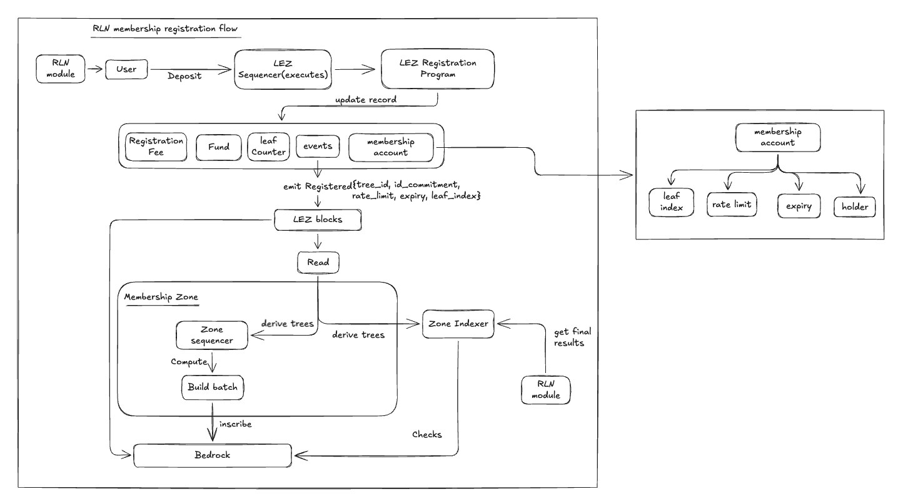

The whole design rests on one idea: **LEZ holds the money and the official record; everyone else
rebuilds the membership tree from that record and checks each other's work.**

| # | What happens | Where | Section |
|---|---|---|---|
| 1 | The registry's rules are configured in `ConfigState` | LEZ | [1](#1-before-anyone-registers-configstate) |
| 2 | The user's Module creates an identity and picks a rate limit and expiry | User's node (off-chain) | [2](#2-create-an-identity) |
| 3 | The Module sends `Register`, signed by a funded account | Module → LEZ Sequencer | [3](#3-send-register) |
| 4 | The registration program checks the inputs, locks the deposit, assigns a leaf index, creates the membership account, and emits `Registered` | LEZ | [4](#4-the-registration-program-executes-on-lez) |
| 5 | The LEZ block closes and is inscribed on Bedrock; the Module reports `PENDING` | LEZ → Bedrock | [5](#5-the-lez-block-closes) |
| 6 | Every reader (the Zone sequencer and every Zone indexer) derives the tree from the events and records one root per LEZ block | Off-chain | [6](#6-readers-derive-the-tree) |
| 7 | On its turn, a Zone sequencer publishes a batch (changes plus `root_after`) to the Zone channel | Zone → Bedrock | [7](#7-publish-the-batch-zone-sequencer--bedrock) |
| 8 | Every Zone indexer checks the batch's range, changes and root, and marks it Verified or Rejected | Off-chain, reading Bedrock | [8](#8-verify-the-batch-every-zone-indexer) |
| 9 | Once the batch is deep enough, its root is valid; the Module reads it and reports `ACTIVE` | Indexer → Module | [9](#9-activation-indexer--module) |
| 10 | The member sends messages with RLN proofs; validators check them, and double-signals lead to slashing | Network | [10](#10-use-proofs-and-validation) |

### Who does what

| Component | Runs | Holds | Writes to |
|---|---|---|---|
| RLN Module | Each user's node | Identity secret, membership view | LEZ (`Register`, `Extend`, `Erase`, `Slash`) |
| LEZ Sequencer | LEZ | LEZ state | LEZ blocks; the LEZ channel on Bedrock |
| Registration program | LEZ (on-chain) | `ConfigState`, escrow, membership accounts (**no tree**) | Emits events |
| Zone sequencer | Zone operator's machines | Its own derived tree; accredited key | The Zone channel on Bedrock |
| Zone indexer | Any node, no key | Its own derived tree, root history | Nothing; it serves Modules |
| Bedrock | Logos base layer | LEZ blocks and Zone batches, ordered and finalized | — |

### Trust in one paragraph

Funds only ever sit on LEZ; the Zone holds none. The Zone sequencer cannot fake a root, because every
indexer recomputes it from LEZ. It *can* censor by omitting a change, which is provable but carries no
penalty in the RFC today. A Module trusts its indexer for roots and proof paths; running your own
indexer reduces that to trusting only the LEZ Sequencer, like any LEZ user.

### Why not keep the tree on LEZ?

| | lez-rln (tree on LEZ) | Membership Zone |
|---|---|---|
| Gas per registration | ~9.09M of 10M per LEZ block | A cheap LEZ transaction |
| Registrations per LEZ block | 1 | Many |
| Effect on other LEZ users | Each registration raises the next block's base fee by ~10% | None from hashing |
| Tree capacity | Depth 9, 512 leaves for the registry's lifetime | Depth 20, ~1M leaves |


## 1. Before anyone registers: `ConfigState`

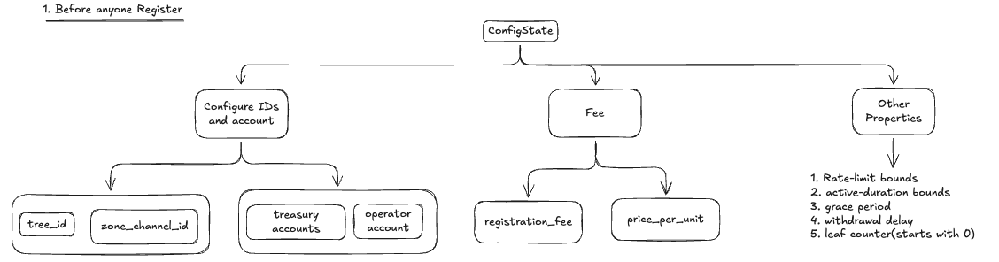

Before the first membership exists, the registry is configured on LEZ in a single account,
`ConfigState`, owned by the registration program. It is the anchor of the registry: every rule that a
`Register`, `Extend`, `Erase` or `Slash` is checked against comes from here. One deployed program can
host several registries; each has its own `ConfigState`, escrow and membership accounts, identified by
`tree_id`.

`ConfigState` lives on LEZ, not in the Zone. The Zone stores no configuration; it only publishes batches.
Modules read `ConfigState` through their Zone indexer, which follows LEZ anyway.

### Identity and routing

| Field | Purpose |
|---|---|
| `tree_id` | Names this registry. Every event carries it, and readers only process events with their own `tree_id`. |
| `zone_channel_id` | The Bedrock channel where the Zone sequencer posts batches and where Zone indexers read them. |

### Accounts and money

| Field | Purpose |
|---|---|
| `operator_account_id` | Receives `registration_fee`. Meant to fund the Zone operator's Bedrock fees for publishing batches. |
| `treasury_account_id` | Receives slashed deposits. |
| `registration_fee` | Non-refundable fee paid with every `Register`. |
| `price_per_unit` | Sets the refundable deposit: `deposit = rate_limit × price_per_unit`. A higher rate limit puts more stake at risk. |

### Bounds

| Field | Purpose |
|---|---|
| `min_rate_limit` / `max_rate_limit` | Range of messages per epoch a member may register for. |
| `min_active_duration_ms` / `max_active_duration_ms` | Shortest and longest membership duration at `Register` and `Extend`. |

### Lifecycle timing

| Field | Purpose |
|---|---|
| `grace_period_duration_ms` | Window before expiry in which `Extend` is allowed. |
| `withdrawal_delay_ms` | Wait after expiry before `Erase` refunds the deposit, so any pending slash lands first. |

Both are **copied into each membership at `Register`** and stay fixed for that membership. A later change
to `ConfigState` reaches an existing membership only through `Extend`.

### Counter

| Field | Purpose |
|---|---|
| `next_index` | The next free leaf slot in the tree. Starts at 0, only goes up, and is never reused. `Register` fails once it reaches 2^20. |

### Messaging

| Field | Purpose |
|---|---|
| `epoch_size_sec` | Length of an RLN epoch. Modules read it so senders and validators agree on time windows. |

> **Open in the RFC:** who sets or changes `ConfigState`, and who holds the operator and treasury
> accounts, is not yet specified (RFC Open Question Q7).


## 2. Create an identity

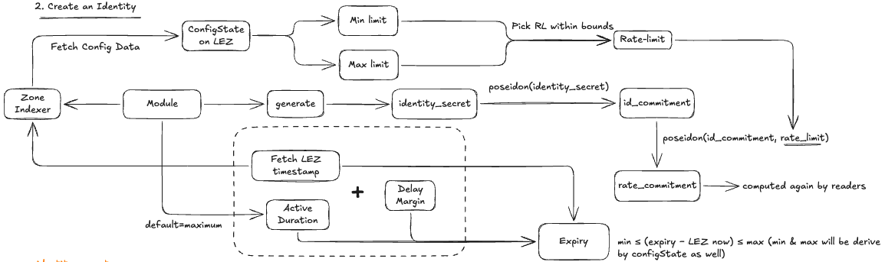

Everything in this step happens **off-chain, inside the user's Module**. Nothing is sent yet.

### Read the registry's rules

The Module asks its **Zone indexer** (its registry access) for two things:

- **`ConfigState`**, for the rate-limit bounds (`min_rate_limit`, `max_rate_limit`) and the duration
  bounds (`min_active_duration_ms`, `max_active_duration_ms`). `ConfigState` lives on LEZ; the indexer
  serves it because it follows LEZ anyway.
- **The latest LEZ timestamp**. The registry tells time by LEZ block timestamps, not by the user's clock.

### Pick a rate limit

The user picks a `rate_limit`, meaning messages per epoch, within the configured bounds. It also sets
the deposit: `rate_limit × price_per_unit`.

### Generate the identity

| Value | How it is made | What it is for |
|---|---|---|
| `identity_secret` | Random, generated by the Module, never shared | The private key of the membership. Whoever knows it can send as this member; if the member spams, it is revealed and the deposit is slashed. |
| `id_commitment` | `poseidon(identity_secret)` | The public ID. Safe to publish on LEZ, because the secret cannot be recovered from the hash. Proofs later show "I know the secret behind one of these commitments" without saying which one. |
| `rate_commitment` | `poseidon(id_commitment, rate_limit)` | The leaf that will sit in the tree. It locks the rate limit into the leaf, so proofs cannot claim more messages per epoch than were paid for. |

The Module does **not** send `rate_commitment`. Every reader computes it again from the `Registered`
event when it derives the tree (step 6).

### Set the expiry
- **expiry** = latest LEZ timestamp + active duration + margin
- **Active duration** is the user's choice and defaults to `max_active_duration_ms`.
- **Margin**: the program measures the duration from the clock of the LEZ block that *includes* the
  transaction, which comes slightly later than the timestamp the Module read. Without a margin, a
  request at exactly the minimum would arrive slightly short and be rejected.
- **Constraint:** `min_active_duration_ms ≤ (expiry − LEZ now) ≤ max_active_duration_ms`, with both
  bounds taken from `ConfigState`.

## 3. Send `Register`

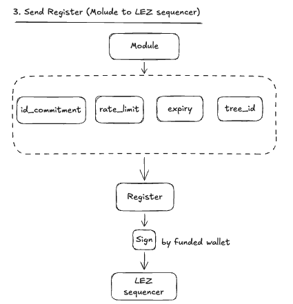

The Module packages four values into a `Register` instruction and sends it to the **LEZ Sequencer**:

```rust
Register {
    tree_id,              // which registry
    id_commitment,        // the public ID from step 2
    rate_limit,           // messages per epoch
    expiry_timestamp_ms,  // from step 2
}
```

- **Signed by the user's funded account.** That account pays the deposit and `registration_fee`, and
  becomes the membership's `holder`: the only account that can later `Extend` or `Erase`, and the one
  that receives the refund.
- **Must be a public transaction.** LEZ records no events from private execution, and readers need the
  `Registered` event to derive the tree. The funded account should therefore be a public account,
  because a refund to a private account ID would land where no key can spend it.
- **Delegated registration:** a membership provider can send the same `Register` from its own funded
  account on the user's behalf. It then becomes `holder`, and the user acts through the provider for
  `Extend` and `Erase`.


## 4. The registration program executes (on LEZ)

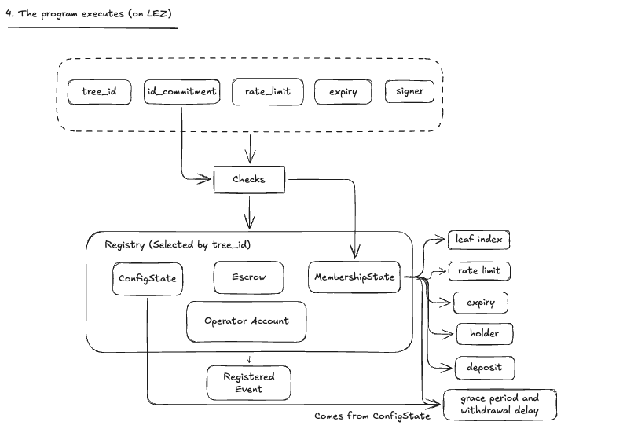

The LEZ Sequencer runs the `Register` transaction through the registration program. The program first
checks every input, then updates the registry selected by `tree_id`, then emits an event. If any check
fails, the transaction is not included in the LEZ block, so nothing changes and no event is emitted.

### Checks: what each input is tested against

| Input | Check | Then used for |
|---|---|---|
| `tree_id` | Selects the registry | Chooses which `ConfigState`, escrow and membership accounts the program uses |
| `id_commitment` | No membership account exists for it yet (one registration per identity, ever; a closed account never reopens) | Key of the new `MembershipState` account |
| `rate_limit` | Within `min_rate_limit` and `max_rate_limit` from `ConfigState` | Deposit = `rate_limit × price_per_unit`; stored in the membership |
| `expiry_timestamp_ms` | `min_active_duration_ms ≤ expiry − now ≤ max_active_duration_ms` | Stored in the membership |
| signer | Has enough funds for the deposit plus `registration_fee` | Becomes `holder` |
| (capacity) | `next_index < 2^20` | — |

`now` comes from the LEZ clock account (`CLOCK_01`), which holds the timestamp of the previous LEZ block.
This is why the Module added a margin in step 2.

### Effects

| Account | Change |
|---|---|
| `ConfigState` | `leaf_index = next_index`, then `next_index` increases by 1. Indices are never reused. |
| Escrow | Receives the deposit (`rate_limit × price_per_unit`). Only the program can spend it. |
| Operator account | Receives `registration_fee` (non-refundable). |
| `MembershipState` (new, keyed by `id_commitment`) | Stores `leaf_index`, `rate_limit`, `expiry_timestamp_ms`, `holder`, `deposit_amount`, plus `grace_period_duration_ms` and `withdrawal_delay_ms` **copied from `ConfigState`** and fixed for this membership. |

The program **keeps no Merkle tree**. That is the key difference from the earlier LEZ-hosted registry
(lez-rln), which hashed the tree inside the zkVM at about 9.09M of the 10M gas available per LEZ block.

### Event

```rust
Registered {
    tree_id,
    id_commitment,
    rate_limit,
    expiry_timestamp_ms,
    leaf_index,
}
```

This event carries everything a reader needs to place the new leaf in the tree, and it is the only input
readers use (step 6).


## 5. The LEZ block closes

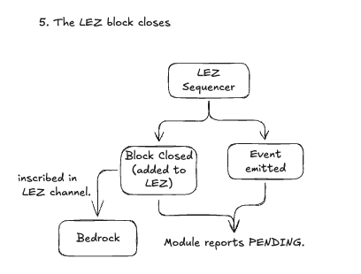

### LEZ Sequencer

The operator of LEZ. It takes the `Register` transaction, runs the registration program (step 4), and
packs the result into the next LEZ block. This is the first point at which the registration exists in
public.

### Event emitted

While the program runs, it emits `Registered{tree_id, id_commitment, rate_limit, expiry_timestamp_ms,
leaf_index}`. Events are **not** stored inside the block, not covered by the block hash, and not
inscribed on Bedrock. They are produced by executing the block, so the LEZ Sequencer, which executed it,
serves them. Readers depend on this event to build the tree.

### Block closed (added to LEZ's chain)

The sequencer closes the block and gives it the next `block_id` on LEZ's own chain. The block holds the
transactions, and its `timestamp` becomes the registry's clock: expiry is measured against it. Once the
block is closed, readers can fetch it and its events immediately, without waiting for finality.

### Inscribed in the LEZ channel → Bedrock

The sequencer posts the closed block into LEZ's channel on Bedrock. A LEZ block has **no finality of its
own**: it becomes final only when the Bedrock block holding its inscription does. A reader that wants to
trust nobody can re-execute LEZ from this channel (through a LEZ Indexer) instead of trusting the LEZ
Sequencer, at the cost of trailing by Bedrock finality.

### Module reports `MEMBERSHIP_PENDING`

The user's Module sees that the registration has landed on LEZ, but no valid root contains its leaf yet.
Until a verified batch carrying the leaf is deep enough on Bedrock (steps 7 to 9), the Module reports
`MEMBERSHIP_PENDING`. This status is something the Module works out; it is not stored on any chain.

> **Assumption the RFC relies on:** the LEZ Sequencer never serves a different block under a `block_id`
> it has already served, which means it stores each block durably before serving it. What happens if
> this breaks is RFC Open Question Q6.


## 6. Readers derive the tree

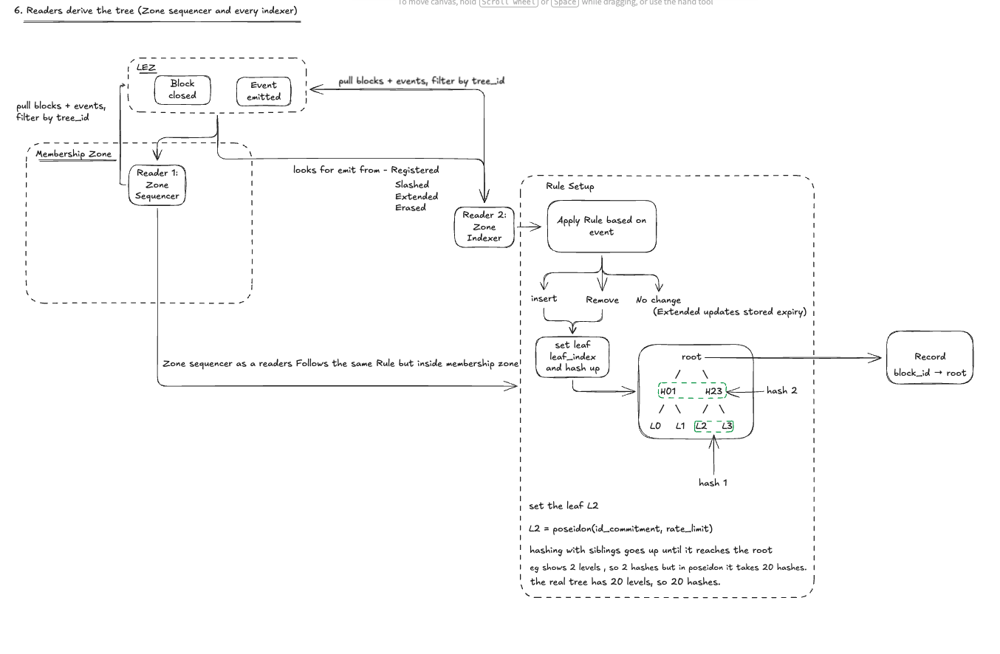

LEZ keeps no tree. Instead, every **reader** rebuilds it from LEZ events using fixed rules. "Reader" is a
role, not a component: the **Zone sequencer** is a reader, and so is **every Zone indexer**. Each one
derives the tree on its own and trusts no other reader's copy.

### What readers pull

Each reader pulls every closed LEZ block and its events from the LEZ Sequencer, and keeps only events
whose `tree_id` matches its registry. It processes blocks in order, and events within a block in the
order they were emitted.

### Derivation rules

| Event | Change to the tree |
|---|---|
| `Registered` | `Insert{leaf_index, poseidon(id_commitment, rate_limit)}` |
| `Slashed` | `Remove{leaf_index}`, if the leaf is still live |
| `Extended` | No change. The reader updates the expiry it has stored for that leaf. |
| `Erased` | No change. The leaf was already removed at expiry. |

**After each block:** every live leaf whose expiry is at or below that block's `timestamp` is removed
(`Remove{leaf_index}`), in increasing leaf-index order. A leaf expires at most once. Readers know each
leaf's expiry from the `Registered` and `Extended` events.

### How one change updates the root

The tree has a fixed depth of 20, giving 2^20 slots. Every slot starts as the empty value at
`first_lez_block_id`, the block that created the registry. To apply an `Insert` or `Remove`, a reader:

1. sets the slot at `leaf_index`, to the rate commitment for an insert or to the empty value for a
   removal;
2. hashes it with its sibling, then hashes the result with the next sibling up, until it reaches the
   root.

The diagram shows a 2-level tree, which takes 2 hashes. The real tree has 20 levels, so each change
costs **20 Poseidon hashes**. They run on ordinary machines, outside the zkVM, which is what makes
registration cheap compared with the earlier LEZ-hosted design.

### Record one root per LEZ block

After applying a block, each reader records `block_id → root`. This record is what lets a Zone indexer
later check any batch, whatever range of LEZ blocks it covers (step 8).

### Why every reader ends up with the same tree

Every reader starts from the same empty tree and applies the same events, in the same order, under the
same deterministic rules, so every reader arrives at the same root. If one reader's root differs from a
published batch, either that reader or the batch is wrong, and step 8 settles which.

## 7. Publish the batch (Zone sequencer → Bedrock)

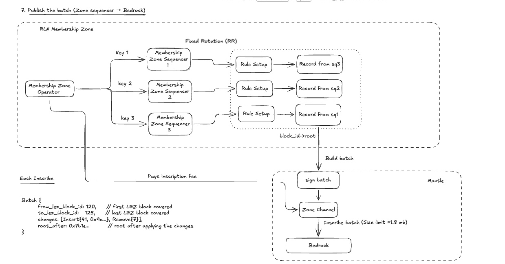

### Who publishes

The **Zone operator** holds the accredited keys of the Zone channel and runs one Zone sequencer per key.
Each sequencer is a reader: it derives the tree itself and keeps its own `block_id → root` record
(step 6). Only accredited keys can write to the Zone channel, and anyone can read it.

### Taking turns

The sequencers take turns writing, in Mantle's fixed **round-robin**. On each turn only **one** sequencer
publishes, using its own record. If a sequencer misses its turn, `posting_timeout` passes it to the next.

### What a batch is

On its turn, a sequencer builds one batch and posts it as **one inscription** (`CHANNEL_INSCRIBE`) inside
**one Mantle transaction**, signed with its accredited key:

```protobuf
message Batch {
  uint64          from_lez_block_id = 1;  // first LEZ block covered, inclusive
  uint64          to_lez_block_id   = 2;  // last LEZ block covered, inclusive
  repeated Change changes           = 3;  // Insert{leaf_index, rate_commitment} | Remove{leaf_index}
  bytes           root_after        = 4;  // root after applying the changes
}
```

Example:

```text
Batch {
from_lez_block_id: 120,
to_lez_block_id: 125,
changes: [Insert{41, 0x9a…}, Remove{7}],
root_after: 0x7b1e…
}
```


A batch carries only what changes the tree. Deposits, expiry times and the reason for a removal stay on
LEZ.

### Publishing rules

| Rule | Meaning |
|---|---|
| Whole LEZ blocks | A batch covers every LEZ block not yet covered by a Verified or in-flight batch, and never splits a block. |
| Size limit | One inscription holds at most about 1.8 MB (1,835,008 bytes). If the changes don't fit, the batch stops early and the next batch continues from there. |
| Maximum delay | Once there is an unpublished change, the sequencer should publish within `max_delay_ms`. Nothing enforces this, but a slow sequencer is visible to everyone because the batches trail behind LEZ. |
| Heartbeat | If nothing has changed for `heartbeat_ms`, the sequencer posts an **empty batch**. It moves `to_lez_block_id` forward, so everyone can see the Zone is still following LEZ. |

### Who pays

Each batch is a Bedrock transaction, paid from the operator's node wallet. That is what
`registration_fee`, collected on LEZ, is meant to cover. Usually only **one batch is in flight** at a
time; the next batch covers everything that closed in the meantime, so nothing is lost. How the fee
actually reaches the operator's Bedrock wallet is RFC Open Question Q4.

### Signed, therefore accountable

Because the channel accepts only batches signed by the operator's keys, nobody else can post a fake
batch. And because every batch is signed and public, a wrong one is permanent evidence against the
operator (see step 8).

### If something goes wrong

If a batch is rejected, dropped from the mempool, or removed by a Bedrock reorg, the sequencer republishes
from the last Verified batch. The tree itself is never lost, because every reader derives it from LEZ.


## 8. Verify the batch (every Zone indexer)

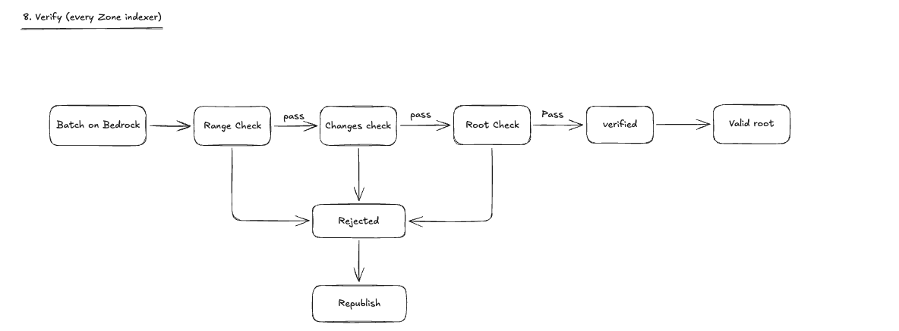

Every Zone indexer checks every batch against the tree it derived itself (step 6). The Zone sequencers
are **not trusted**: a dishonest one is caught by any indexer, though not prevented.

### When it happens

As soon as the batch appears in a Bedrock block. The indexer does not wait for finality to *check* a
batch; waiting only matters later, for when a root becomes *usable* (step 9). Bedrock finality confirms
the result afterwards.

### The three checks

A batch must pass all three, in order. Failing any one rejects it.

| Check | Rule | What it catches |
|---|---|---|
| **1. Range** | `from_lez_block_id` equals the last Verified batch's `to_lez_block_id + 1`. The first batch must start at `first_lez_block_id`. | Skipped or double-covered LEZ blocks |
| **2. Changes** | `changes` exactly match what the indexer derived for that range: the same inserts and removes, in the same order. | **Omitted** changes (provable censorship), **invented** or **reordered** changes |
| **3. Root** | `root_after` equals the root the indexer recorded at `to_lez_block_id`, from its `block_id → root` record. | A wrong root |

If the indexer has not yet read one of the LEZ blocks in the range, the changes check **waits**; it does
not fail.

### Example

The last Verified batch ended at LEZ block 119. A new batch covers 120 to 125.

- **Range:** starts at 120 = 119 + 1 ✅
- **Changes:** the indexer derived `[Insert{41}, Remove{7}]`, and the batch says the same ✅
- **Root:** the indexer's root at block 125 is `0x7b1e…`, and so is `root_after` ✅
- → **Verified**

### Outcomes

| | Verified | Rejected |
|---|---|---|
| Effect | `(root_after, to_lez_block_id)` joins the indexer's **root history** | Changes **nothing**; the indexer stays at the last Verified batch |
| Next batch | Must start at `to_lez_block_id + 1` | Must start again from the last Verified batch. Any batch built on a rejected one is rejected too. |
| Meaning | The published root is correct | The sequencer must republish correctly. The signed batch stays on Bedrock as **public evidence** against the Zone operator. |

A rejected root is never a valid root. A sequencer that leaves out a removal does not keep that leaf
usable; it only stalls the registry at its indexers until a correct batch arrives.

### Reorgs are not misbehaviour

A Bedrock reorg can drop or reorder a batch, so that it fails the range check without anyone cheating.
The sequencer republishes it unchanged, and that does not count as evidence against the operator.

### What happens to evidence

The RFC treats a rejected batch as evidence, but defines **no penalty**: what follows from it is outside
the RFC. Section 11 sketches a proposal for that.


## 9. Activation (indexer → Module)

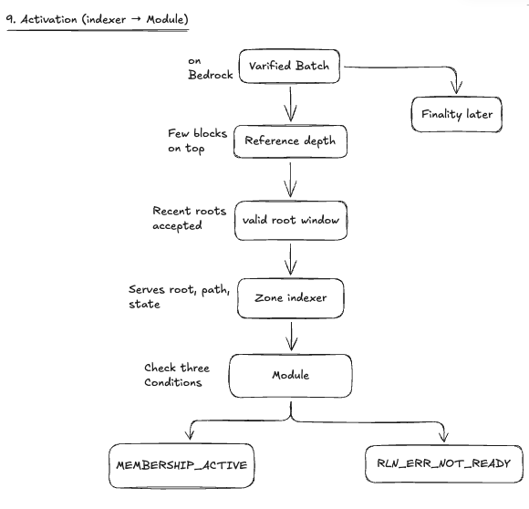

### Buried deep enough: the reference depth

A batch that has just landed on Bedrock could still be dropped or reordered by a short reorg. So a
Verified root only becomes **valid** once its batch has a few Bedrock blocks on top of it. That number is
the **reference depth**. Its exact value is still open in the RFC (Q3); it should be set from the reorg
depths actually observed on the network. Every extra block of depth adds to how long a registration takes
to become active, and how long a removal takes to take effect.

### Valid roots and the valid-root window

Validators accept a short **window** of recent valid roots, not just the newest one. Nodes read Bedrock
at slightly different times, so a proof made against a slightly older root should still pass.

- **An insert keeps older roots sound.** Every leaf in an older root is still in the tree.
- **A removal resets the window.** Older roots still contain the removed leaf (for example, a slashed
  member whose secret is now public), so they are dropped.

The window's length, measured in LEZ blocks, is also open in RFC Q3. A longer window tolerates more
difference between nodes; a shorter one limits how long a removed leaf can still be used at a validator
that is behind.

### What the Module reads from its indexer

| Item | Used for |
|---|---|
| Newest valid root | The root the Module proves against |
| Merkle proof path at that root | The 20 sibling hashes from its leaf to the root. The zero-knowledge proof uses them to show "my leaf is in this tree" without revealing which leaf. |
| Membership state | Whether the account is open, plus `leaf_index`, `rate_limit`, `expiry_timestamp_ms`, `holder` |
| `ConfigState` and the latest LEZ time | Bounds, epoch size, and the registry's clock |

> **Privacy:** asking an indexer for a proof path names the leaf. A Module that must not reveal which
> leaf is its own should run its own Zone indexer.

### `MEMBERSHIP_ACTIVE`

The status changes from `PENDING` to `ACTIVE`. The Module generates proofs only while **all three** of
these hold, and stops as soon as any one fails:

1. its membership account is open;
2. the LEZ time is before its `expiry_timestamp_ms`;
3. its leaf is in a root within the valid-root window.

### Ready vs. not ready

If the indexer is unreachable, or the newest valid root falls too far behind LEZ (more than the window
length), the Module returns **`RLN_ERR_NOT_READY`** instead of working on stale data.

### Finality confirms it later

Bedrock finality (about 60 minutes on testnet, or about 18 hours at the protocol default) makes the batch
permanent. The membership is usable **before** finality, from the reference depth onward; finality only
rules out a deep reorg afterwards.

### Whom the Module trusts

| Setup | Trusts |
|---|---|
| Remote Zone indexer | That indexer's operator (the Module may query several and compare) |
| Own Zone indexer | Only the LEZ Sequencer, like any LEZ user |
| Own Zone indexer reading its own LEZ Indexer | Nobody, at the cost of trailing by Bedrock finality |


## 10. Use: proofs and validation

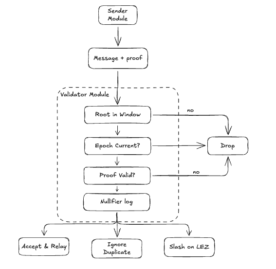

An active member sends messages, and other nodes check them. The same RLN Module plays both roles:
**proof generator** when it sends, **validator** when it receives.

### Sender: build the proof

For every message, the sender's Module builds an RLN proof against the **newest valid root**. Without
revealing who is sending, the proof shows that:

- the sender knows the `identity_secret` behind a leaf in this tree, using the secret and the 20-hash
  proof path, both kept private;
- the message fits within the sender's `rate_limit` for the current epoch;
- the **nullifier** was computed correctly. It is the same whenever the same message slot is reused in the
  same epoch, so reuse is detectable;
- the **share** was computed correctly. It is a point derived from the message; two different shares
  under the same nullifier reveal `identity_secret`.

The message travels with the proof and its public values: the root, epoch, nullifier and share.

### Validator: four checks

| Check | If it fails |
|---|---|
| **Root in window?** If the root is unknown, the validator first asks its indexer for newer batches, at most once per Bedrock block interval. | Drop |
| **Epoch current?** | Drop |
| **Proof valid?** | Drop |
| **Nullifier log** | See below |

### Nullifier log outcomes

| Nullifier | Message | Outcome |
|---|---|---|
| New in this epoch | — | **Accept and relay**, and record the nullifier |
| Seen before | Same message | **Ignore** as a duplicate |
| Seen before | Different message | **Double-signal**: the two shares reveal `identity_secret` → **slash** |

### The slashing loop

A double-signal feeds back into the start of the flow:

1. The validator hands `recovered_secret` to a **slasher**, or sends the `Slash` itself.
2. The slasher sends `Slash{tree_id, identity_secret}` to LEZ from any funded account.
3. The registration program moves the whole deposit to `treasury_account_id`, closes the membership, and
   emits `Slashed`.
4. Every reader removes the leaf as soon as that LEZ block closes (step 6).
5. The next batch carries `Remove{leaf_index}` (steps 7 and 8).
6. Once that batch is deep enough, validators reset their root window and stop accepting the leaf
   (step 9).

The violator's Module reports `MEMBERSHIP_SLASHED` from step 3 onward. The RFC defines no slasher reward
today (Open Question Q4).

### Newest root vs. window

The sender proves against the freshest root; the window lets validators that are slightly behind still
accept it. After a removal resets the window, an honest proof made against an older root fails and is
simply generated again against the new one.

### Status timeline

| Moment | What happened | Module status |
|---|---|---|
| `Register` sent | Transaction waiting for the LEZ Sequencer | — |
| LEZ block closes | Membership account exists; readers insert the leaf | `MEMBERSHIP_PENDING` |
| Batch on Bedrock | Indexers verify it | `MEMBERSHIP_PENDING` |
| Batch deep enough | Root becomes valid; the leaf is usable | `MEMBERSHIP_ACTIVE` |
| Bedrock finality (~60 min on testnet) | Batch is permanent | `MEMBERSHIP_ACTIVE` (confirmed) |

`ACTIVE` typically arrives within minutes: the LEZ block, plus the sequencer's publish delay, plus a few
Bedrock blocks.

---

## References

- [RFC: RLN Membership Zone](rfc-rln-membership-zone.md)
- [RLN-API](https://lip.logos.co/anoncomms/raw/rln-api.html)
- [logos-lez-rln](https://github.com/logos-co/logos-lez-rln), the current LEZ-hosted registry
- [Bedrock v1.1 Mantle specification](https://lip.logos.co/blockchain/raw/bedrock-v1.1-mantle-specification.html)
- [Trust-minimized Logos Zones Interoperability (forum draft)](https://forum.research.logos.co/t/trust-minimized-logos-zones-interoperability-draft-idea/737)

## Disclaimer

This walkthrough reflects one contributor's reading of a raw draft that is still changing. Corrections are
welcome. Please open an issue or comment on the PR.